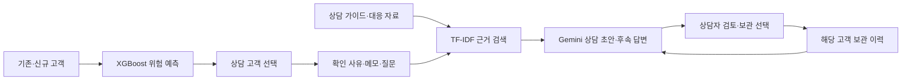

# Project2[README.md](https://github.com/user-attachments/files/34253767/README.md)
# 은행 고객 이탈 상담 지원 모델

**고객 이탈 예측부터 상담 준비까지, 텔레마케터를 위한 고객 상담 지원 AI**


## 프로젝트 개요

은행 고객의 이탈 위험을 분석하고, 상담자가 고객에게 연락하기 전에 AI와 상담 방향을 검토할 수 있는 Streamlit 웹 애플리케이션입니다. 머신러닝·신경망 비교를 통해 선정한 XGBoost 예측 결과에 고객이 확인한 사유, 상담 가이드 검색 결과, 고객별 과거 상담 이력을 결합합니다.

**고객 분석 → 위험 진단 → 상담 질문·초안 생성 → 후속 질문 → 기록 보관**을 하나의 화면 흐름으로 연결합니다. 실제 연락이나 금융 혜택의 자동 승인은 수행하지 않습니다.

## 프로젝트 기간

**2026.10.27 ~ 2026.11.02 · 총 7일**

## 프로젝트 구성원 및 역할

| 구성원 | 수행 형태 | 역할 |
| --- | --- | --- |
| 국경민 | 개인 프로젝트 | 기획, 데이터 분석·전처리, 모델 비교·선정, 웹 개발, 상담 자료 정리, RAG·생성형 AI 연결, 기능 검증·문서화 |

## 프로젝트 배경 및 필요성

고객 이탈은 은행과의 거래 관계가 종료되거나 약화되는 현상입니다. 수수료, 상품 조건, 디지털 이용 불편, 상담 경험 등 여러 요인이 영향을 줄 수 있어 예측 점수만으로 실제 사유를 단정하기 어렵습니다. 은행 고객 경험 조사에서도 디지털 경험과 서비스 마찰을 고객 유지의 과제로 다룹니다. [Baringa 조사](https://www.baringa.com/en/insights/architecting-loyalty-in-financial-services/retail-banking-survey/), [EY 분석](https://www.ey.com/en_ca/insights/banking-capital-markets/why-loyalty-is-becoming-retail-bankings-next-competitive-battleground)

본 프로젝트는 이탈 예측 분석을 텔레마케터의 상담 준비 과정으로 확장했습니다. 상담자는 위험 고객의 정보를 확인하고 고객 상황과 질문을 입력해 상담 초안을 미리 검토할 수 있습니다. 상담자의 경험에만 의존하던 준비 과정에 데이터와 문서 근거를 함께 제공하는 것이 AI 도입의 목적입니다. 실제 이탈 감소 효과는 별도 운영 실험이 필요합니다.

## 프로젝트 목표

1. 기존 고객의 이탈 위험 분포와 개별 예측 요인을 확인합니다.
2. 머신러닝과 신경망을 비교하고 검증 지표로 운영 모델을 선정합니다.
3. 단일·대량 신규 고객을 예측하고 검토 후 원본 고객 자료에 추가합니다.
4. 고객 정보·확인 사유·문서 근거를 바탕으로 상담 질문과 초안을 생성합니다.
5. 고객별 상담 기록을 보관·검색·요약하고 다음 상담에 활용합니다.

## 주요 기능

| 페이지 | 주요 기능 |
| --- | --- |
| 이탈 리스크 대시보드 | 위험 등급별 고객 규모, 예측 확률 분포, 필터 |
| 개별 고객 진단 | 고객명·번호 검색, 이탈 확률, 개별 예측 기여도, 상담 지원 이동 |
| 신규 고객 예측 | 1명 직접 입력·대량 파일 업로드, 예측 결과 검토, 단일·일괄 원본 등록 |
| 모델 성능 검증 | XGBoost·MLP 비교, 선정 결과, 임계값별 지표, 혼동행렬·확률 구간 비교 |
| 고객 상담 지원 AI | 사유·메모 입력, 1차 상담 초안·후속 답변, 문서 출처, 고객별 기록·요약 |

입력은 연한 파란색 영역, 결과는 흰색 카드로 구분합니다. 관리 임계값을 사이드바에서 조절할 수 있으며 페이지별 스크롤 위치를 기억합니다.

## 데이터 및 전처리

로컬 원본은 `Churn_Modelling.csv`이며 프랑스·독일·스페인 고객 정보를 포함합니다. 국내 은행 적용을 위한 별도 검증은 수행하지 않았습니다. 원본 배포 출처·이용 조건은 별도 확인이 필요하므로 출처를 임의로 확정하지 않았습니다.

| 구분 | 컬럼 |
| --- | --- |
| 식별·표시 | `CustomerId`, `Surname`, 신규 등록 고객의 `name` |
| 예측 입력 | `CreditScore`, `Age`, `Tenure`, `Balance`, `NumOfProducts`, `HasCrCard`, `IsActiveMember`, `EstimatedSalary`, `Geography`, `Gender` |
| 실제 결과 | `Exited` · 신규 등록 시 미확인으로 저장 |

고객명·번호는 예측 입력에서 제외합니다. 저장된 변환 로직으로 연령대·범주형 변환과 스케일링을 적용합니다. 지원 연령은 앱의 모델 범위를 따릅니다. 기존 고객은 이름 전용 컬럼이 없으면 `Surname`을 표시하므로 동명이인이 있을 수 있습니다.

신규 등록은 원본을 백업한 뒤 수행합니다. 일괄 등록은 전체 파일을 한 번에 저장하고 새 고객 번호를 부여합니다. 기존 고객 갱신·실제 중복 인물 판별은 수행하지 않으며, 같은 등록 요청의 재실행은 등록 토큰으로 방지합니다. 예측 점수를 실제 이탈 결과로 저장하지 않습니다.

## 모델 비교 및 최종 선정

과거 실험 기록과 현재 공통 학습·검증 분리에서 수행한 비교 결과를 구분합니다. **최종 선정 비교 대상은 XGBoost와 MLP 신경망**입니다. MLP는 은닉층 64–32–16의 다층 신경망이며, 모든 딥러닝 구조를 탐색했다는 의미는 아닙니다.

학습 **6,045명**, 검증 **1,512명**, 기존 평가 고객 **1,890명**을 사용했습니다. 모델과 임계값은 **검증 F1**을 기준으로 선정했습니다.

| 모델 | 임계값 | 검증 F1 | 평가 정확도 | 평가 정밀도 | 평가 재현율 | 평가 F1 | 평가 ROC-AUC |
| --- | ---: | ---: | ---: | ---: | ---: | ---: | ---: |
| **XGBoost · 선정** | **44%** | **0.6697** | **83.54%** | **58.88%** | **63.02%** | **0.6088** | **0.8509** |
| MLP 신경망 | 31% | 0.6295 | 82.22% | 55.97% | 58.59% | 0.5725 | 0.8184 |

출처: [`reports/trained_comparison.csv`](reports/trained_comparison.csv), [`reports/model_training_note.md`](reports/model_training_note.md).XGBoost의 검증 F1이 더 높아 최종 선정했습니다. 기존 평가 자료를 재사용했으므로 완전히 독립적인 최종 시험 성능으로 주장하지 않습니다. 화면 임계값을 바꾸면 관리 대상과 지표가 달라집니다.

예측 확률은 모델 점수이며 실제 이탈이나 사유를 확정하지 않습니다. 개별 기여도 역시 인과관계를 입증하지 않습니다.

## 고객 상담 지원 AI · RAG

관련 문서를 먼저 검색한 뒤 고객 정보와 검색 근거를 생성형 모델에 전달합니다.



| 구성 | 구현 |
| --- | --- |
| 검색 | TF-IDF, 주제 필터, 한국어·영어 용어 확장 · 임베딩 API·벡터 DB 불필요 |
| 생성 | Gemini `gemini-3.1-flash-lite` 기본 설정 · FreeLLMAPI·Ollama 연결 지원 |
| 출처 | 근거 번호·문서명·페이지 또는 웹 본문·원문 링크 |
| 기록 | `private_logs/counseling.log.db` · 고객별 보관·검색·내려받기 |
| 후속 대화 | 해당 고객의 최근 보관 메시지 최대 12건 참고 |
| 요약 | 질문 발췌 요약과 모델 연결 시 AI 요약 구분 |

생성 초안은 **상담 내용 보관**을 눌러야 기록에 저장합니다. **보관하지 않기**를 선택하면 다음 답변의 이력에 추가하지 않습니다. 이력 활용은 모델 가중치 재학습이 아닙니다.

문서의 국가·업무 범위가 다를 수 있으며 출처 번호 표시만으로 내용 정확성이 보장되지는 않습니다. 근거에 없는 혜택을 약속하지 않도록 안내하고 최종 상담 내용은 담당자가 검토합니다. 일부 번호·이메일을 마스킹하지만 자유 입력의 모든 개인정보 제거를 보장하지는 않습니다.

## 기술 스택

| 영역 | 기술 |
| --- | --- |
| 웹 | Python, Streamlit |
| 데이터·시각화 | pandas, NumPy, Altair |
| 모델 | XGBoost, scikit-learn MLP, StandardScaler |
| 검색·생성 | TF-IDF, Gemini API, requests |
| 기록·설정 | SQLite, `.env` |

## 실행 방법

프로젝트 폴더에서 저장 모델과 호환되는 Python 환경을 사용합니다. 패키지 버전은 `requirements.txt`를 기준으로 합니다.

```powershell
python -m pip install -r requirements.txt
Copy-Item .env.example .env
notepad .env
python -m streamlit run app.py --server.port 8527
```

이미 `.env`가 있으면 복사 단계를 생략해 기존 설정을 보존하세요. 브라우저에서 `http://localhost:8527`로 접속합니다.

```dotenv
LLM_PROVIDER=gemini
LLM_BASE_URL=https://generativelanguage.googleapis.com/v1beta/openai
LLM_MODEL=gemini-3.1-flash-lite
LLM_API_KEY=발급받은_키
```

[Google AI Studio](https://aistudio.google.com/api-keys)에서 키를 발급해 입력합니다. 화면의 **연결 설정 파일 열기 · 메모장 → 키 입력·저장 → 연결 상태 확인** 순서로도 사용할 수 있습니다. 메모장은 앱 서버가 실행 중인 Windows PC에서 열립니다. 연결 확인은 실제 샘플 생성을 수행하며 API 이용 한도를 사용합니다.

무료 대상·한도·자료 이용 조건은 계정과 프로젝트에서 확인하세요. 앱은 결제 설정을 변경하지 않습니다. 무료 테스트에는 개인정보 없는 샘플을 사용하세요. [Gemini 요금 안내](https://ai.google.dev/gemini-api/docs/pricing)

### GitHub 복제 후 데이터 준비

`.env`, 고객 원본·개인별 예측 자료·상담 기록·백업·외부 문서 본문은 공개 업로드에서 기본 제외합니다. 따라서 **코드만 복제하면 완전한 데이터 화면과 상담 검색이 바로 동작하지 않습니다.** 적법하게 확보한 자료를 아래 위치에 준비하세요.

```text
Churn_Modelling.csv
data/customer_risk.csv
data/permutation_importance.csv
data/rag_ready/<자료수집폴더>/knowledge.jsonl
models/Selected_Model.pkl
models/model_metadata.json
reports/trained_comparison.csv
reports/training_audit.json
```

현재 로컬 제출 폴더에는 실행 자료와 모델이 포함되어 있습니다. 공개 배포 전 데이터·모델·문서의 이용 조건을 확인하세요. 이 제출본에 크롤링 실행 파일이 포함되어 있다고 가정하지 않으며 상담 자료는 별도로 준비합니다.

## 폴더 구조

```text
.
├── app.py                  # 대시보드·진단·신규 예측·성능 검증
├── advisor_page.py         # 고객 상담 지원 AI
├── navigation.py           # 사이드바·스크롤 관리
├── project_model.py        # 모델 로드·변환
├── churn_core.py           # 등급·필터·평가
├── customer_store.py       # 단일·일괄 고객 등록·백업
├── rag_engine.py           # 근거 검색
├── chat_backend.py         # 모델 연결·상담 기록
├── models/                 # 저장 모델
├── reports/                # 비교 지표·학습 기록·학습 코드
├── notebooks/              # 분석 노트북
├── data/                   # 분석 결과·로컬 상담 자료
├── private_logs/           # 실행 시 생성·공개 제외
├── .env.example            # 비밀값 없는 예시
├── requirements.txt
├── VERSION
└── CHANGELOG.md
```

## 검증 및 한계

메뉴 연결, 고객 검색, 저장 모델 예측, 상담 초안 보관·미보관, 고객별 이력 전달, 등록 흐름을 점검했습니다. Gemini 샘플 상담 생성도 확인했습니다. 실제 이탈 감소나 상담 성과 향상은 아직 측정하지 않았습니다.

신규 등록은 자동 재학습을 수행하지 않습니다. 실제 이탈 결과가 쌓인 후 별도 학습·검증이 필요합니다. 현재는 로컬 과제 시연용으로 사용자 인증·역할별 권한·기록 암호화 등 다중 사용자 운영 기능은 별도 보완 대상입니다. 학습 코드의 과거 로컬 경로는 재학습 시 현재 환경에 맞게 수정해야 합니다.

## 기대 효과 및 향후 개선

상담자가 고객 특징과 확인 질문을 빠르게 검토하고, 이전 기록을 다음 상담에 참고하도록 지원합니다. 향후 국내 업무 규정 기반 자료 확충, 검색·답변 품질 평가, 장기 이력 요약, 접근 통제, 독립 시험 자료와 실제 상담 성과 검증을 진행할 수 있습니다.

## 참고 자료

- [Baringa 은행 고객 경험 조사](https://www.baringa.com/en/insights/architecting-loyalty-in-financial-services/retail-banking-survey/)
- [EY 은행 고객 충성도 분석](https://www.ey.com/en_ca/insights/banking-capital-markets/why-loyalty-is-becoming-retail-bankings-next-competitive-battleground)
- [Gemini API](https://ai.google.dev/gemini-api/docs)
- [FreeLLMAPI](https://github.com/tashfeenahmed/freellmapi)

## 버전

현재 제출 버전은 **v007**입니다. 이전 v006을 보존하며 다음 명시적 저장 요청 때 새 번호의 폴더를 만듭니다. GitHub 원격 업로드는 수행하지 않았습니다.
