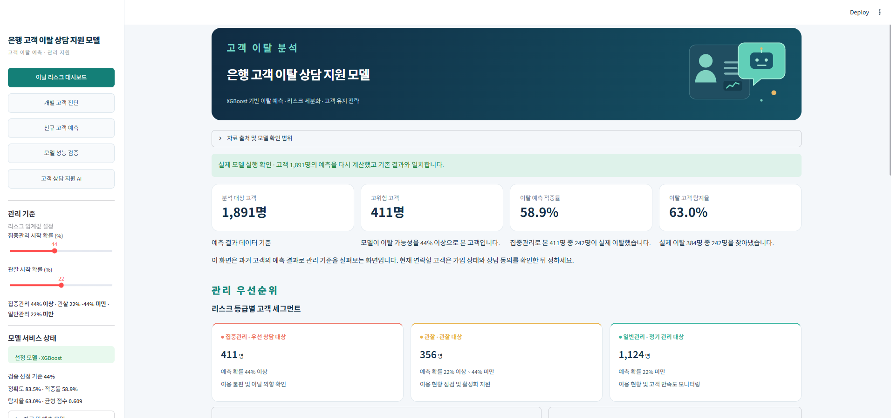
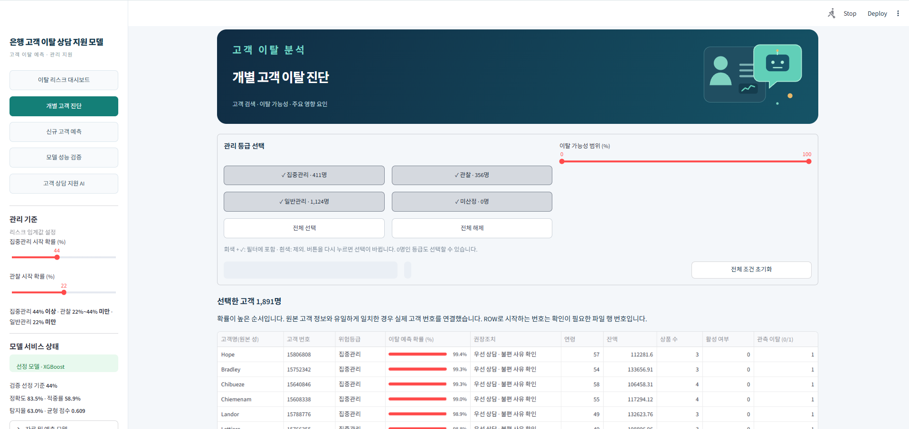
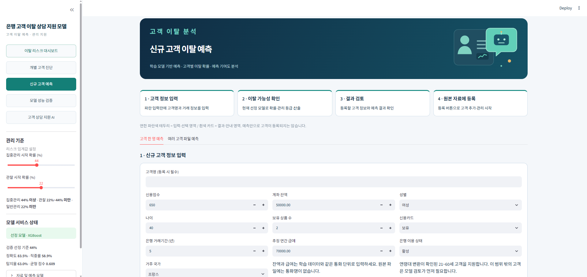
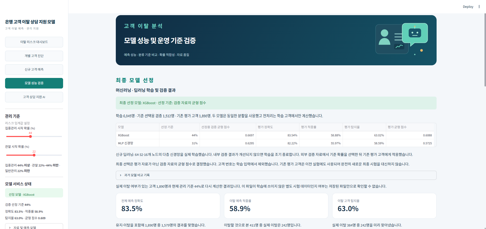
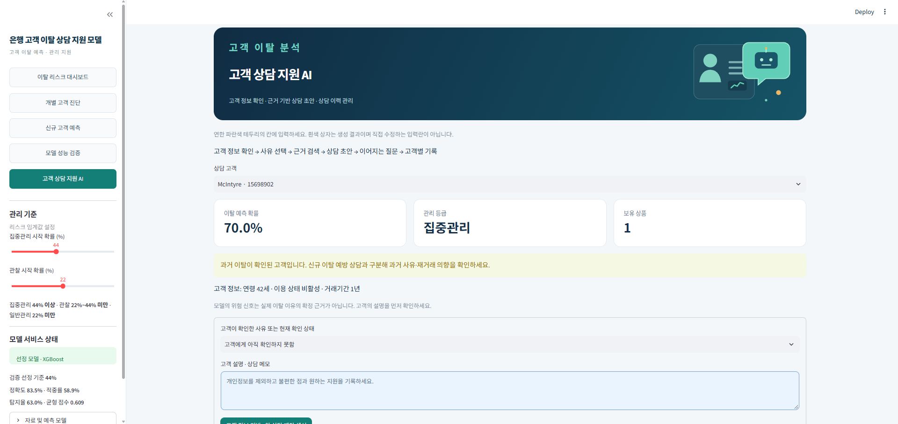
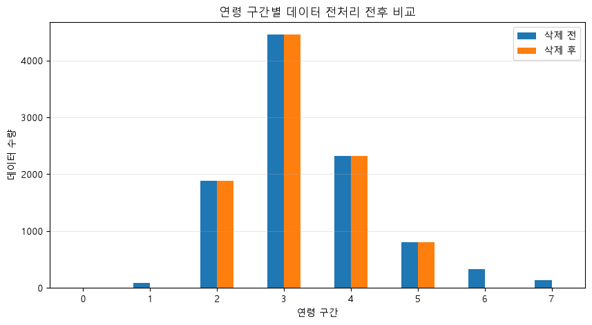
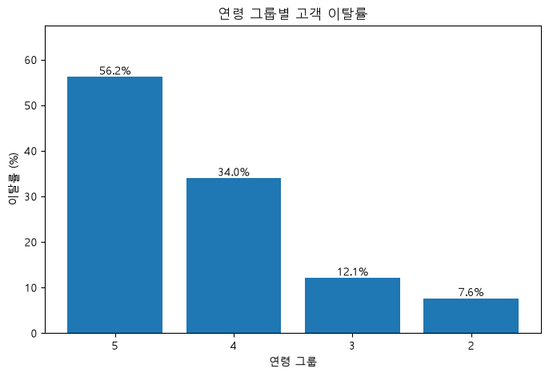
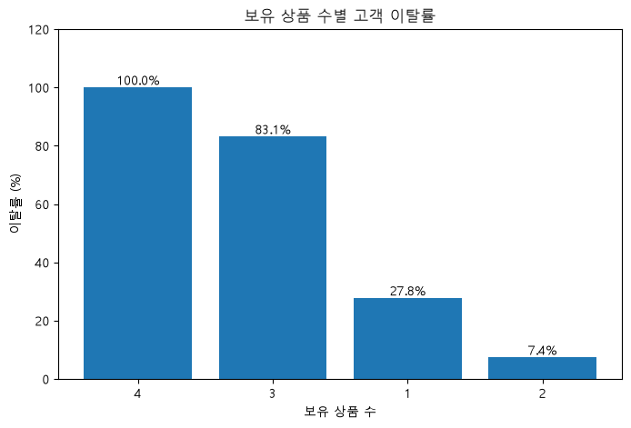
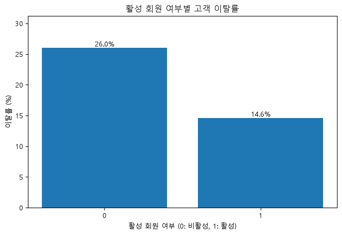
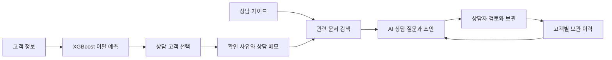

# 은행 고객 이탈 상담 지원 모델

**고객 이탈 예측부터 상담 준비까지, 텔레마케터를 위한 고객 상담 지원 AI**


## 프로젝트 시연 영상

아래 링크를 누르면 영상 파일을 내려받을 수 있습니다.

- [▶ 프로젝트 시연 영상 1부]([은행고객_상담AI_1부.mp4?raw=1](https://github.com/nateous-dev/Project2/blob/main/%EC%9D%80%ED%96%89%EA%B3%A0%EA%B0%9D_%EC%83%81%EB%8B%B4AI_1%EB%B6%80.mp4))
- [▶ 프로젝트 시연 영상 2부](은행고객_상담AI_2부.mp4?raw=1)

## 프로젝트 개요

은행 고객의 이탈 위험을 분석하고, 상담자가 고객에게 연락하기 전에 AI와 상담 방향을 검토할 수 있는 Streamlit 웹 애플리케이션입니다.

XGBoost 모델의 예측 결과에 고객이 확인한 사유, 상담 가이드 검색 결과, 고객별 과거 상담 이력을 결합해 상담 준비를 지원합니다.

**고객 분석 → 위험 진단 → 상담 질문·초안 생성 → 후속 질문 → 상담 기록 보관**

## 프로젝트 기간 및 구성원

- **기간:** 2026.10.30 ~ 2026.11.02 · 실제 작업 2일
- **구성원:** 국경민 · 개인 프로젝트
- **담당:** 기획, 데이터 분석·전처리, 모델 비교·선정, 화면 개발, RAG·생성형 AI 연결, 검증 및 문서화

## 프로젝트 배경

은행 고객의 이탈에는 상품 조건, 수수료, 이용 불편, 상담 경험 등 다양한 요인이 영향을 줄 수 있습니다. 따라서 예측 점수로 상담 우선순위를 살펴보고, 실제 사유는 고객과의 대화에서 확인할 필요가 있습니다.

본 프로젝트는 고객 이탈 분석을 텔레마케터의 상담 준비 과정에 연결합니다. 상담자는 고객 정보와 과거 상담 내용을 살펴보고, AI가 제안하는 확인 질문과 상담 초안을 검토해 통화를 준비할 수 있습니다.

## 프로젝트 목표

1. 기존 고객의 이탈 위험 분포와 개별 예측 요인을 확인합니다.
2. 머신러닝과 신경망을 비교해 운영 모델을 선정합니다.
3. 단일·대량 신규 고객을 예측하고, 검토 후 고객 자료에 등록합니다.
4. 고객 정보와 상담 사유를 바탕으로 질문과 상담 초안을 생성합니다.
5. 고객별 상담 기록을 보관·검색·요약하고 다음 상담에 활용합니다.

## 주요 기능

| 페이지 | 주요 기능 |
| --- | --- |
| 이탈 리스크 대시보드 | 위험 등급별 고객 규모와 예측 확률 분포 확인 |
| 개별 고객 진단 | 고객 검색, 이탈 확률과 개별 예측 기여도 확인 |
| 신규 고객 예측 | 고객 한 명 또는 여러 고객의 파일 예측 및 등록 |
| 모델 성능 검증 | XGBoost·MLP 비교와 관리 기준별 지표 확인 |
| 고객 상담 지원 AI | 상담 사유 입력, 초안 생성, 후속 질문 및 상담 이력 관리 |

## 화면 구성

### 1. 이탈 리스크 대시보드

전체 고객의 예측 결과와 관리 등급별 고객 수를 확인합니다.



### 2. 개별 고객 진단

관리 등급과 이탈 가능성 범위로 고객을 선택하고 개별 정보를 살펴봅니다.



### 3. 신규 고객 예측

고객 정보를 입력해 이탈 가능성을 확인하고, 결과 검토 후 고객 자료에 등록합니다.



### 4. 모델 성능 검증

XGBoost와 신경망의 비교 결과 및 최종 선정 기준을 확인합니다.



### 5. 고객 상담 지원 AI

고객 정보와 확인 사유를 바탕으로 상담 질문과 초안을 준비합니다.



## 데이터 및 전처리

프로젝트는 프랑스·독일·스페인 고객 정보가 포함된 `Churn_Modelling.csv`를 사용합니다.

| 구분 | 컬럼 |
| --- | --- |
| 고객 식별·표시 | `CustomerId`, `Surname`, 신규 등록 고객의 `name` |
| 예측 입력 | `CreditScore`, `Age`, `Tenure`, `Balance`, `NumOfProducts`, `HasCrCard`, `IsActiveMember`, `EstimatedSalary`, `Geography`, `Gender` |
| 실제 이탈 여부 | `Exited` |

고객명과 고객 번호는 고객을 찾는 데 사용합니다. 신규 고객을 등록할 때 실제 이탈 여부는 미확인 상태로 저장합니다.

## 탐색적 데이터 분석

`project1.ipynb`에서 고객 정보와 실제 이탈 여부를 비교하고, 최종 모델 입력과 상담 화면에 활용할 항목을 살펴봤습니다.

### 연령 구간 전처리

연령을 10세 단위로 구간화하고, 모델이 지원하는 21~60세 고객을 중심으로 분석했습니다.



### 연령 구간별 이탈률

차트의 그룹 2는 21~30세, 그룹 3은 31~40세, 그룹 4는 41~50세, 그룹 5는 51~60세입니다.



### 보유 상품 수별 이탈률

보유 상품 수에 따라 관측된 이탈률을 비교했습니다. 상품 수는 신규 고객 예측과 고객 프로필에 사용합니다.



### 활성 여부별 이탈률

고객의 활성 여부에 따른 이탈률을 비교했습니다. 활성 여부는 예측 입력과 상담 전 고객 정보 확인에 사용합니다.



### EDA에서 최종 화면까지

**고객 정보 확인 → 전처리 → 이탈률 탐색 → 모델 비교 → XGBoost 선정 → 고객별 예측과 상담 준비**

집단별 이탈률과 모델 예측은 상담 우선순위를 살펴보는 자료입니다. 고객의 실제 이탈 사유는 상담에서 확인합니다.

## 모델 비교 및 최종 선정

학습 6,045명, 검증 1,512명, 기존 평가 고객 1,890명을 사용했습니다. 모델과 임계값은 **검증 F1 점수**를 기준으로 선정했습니다.

| 모델 | 임계값 | 검증 F1 | 평가 정확도 | 평가 정밀도 | 평가 재현율 | 평가 F1 |
| --- | ---: | ---: | ---: | ---: | ---: | ---: |
| **XGBoost · 선정** | **44%** | **0.6697** | **83.54%** | **58.88%** | **63.02%** | **0.6088** |
| MLP 신경망 | 31% | 0.6295 | 82.22% | 55.97% | 58.59% | 0.5725 |

XGBoost의 검증 F1이 더 높아 최종 모델로 선정했습니다. 평가 고객은 기존 분석에서 사용한 자료를 재사용했으므로, 향후 새로운 고객 자료로 별도 검증이 필요합니다.

## 고객 상담 지원 AI · RAG

관련 상담 문서를 검색한 뒤 고객 정보와 검색 근거를 생성형 모델에 전달합니다.



- **검색:** TF-IDF를 이용해 관련 상담 자료를 검색합니다.
- **생성:** Gemini 모델을 이용해 상담 질문과 초안을 생성합니다.
- **근거:** 문서명, 페이지 또는 웹 본문과 원문 링크를 확인할 수 있습니다.
- **기록:** 보관한 상담 내용은 고객별로 검색하고 다음 질문에 참고할 수 있습니다.
- **요약:** 이전 상담 내용을 발췌하거나 AI를 이용해 요약할 수 있습니다.

AI가 제안한 내용은 상담자가 근거와 고객 상황을 확인한 뒤 활용합니다.

## 기술 스택

| 영역 | 기술 |
| --- | --- |
| 웹 화면 | Python, Streamlit |
| 데이터 처리·시각화 | pandas, NumPy, Altair |
| 예측 모델 | XGBoost, scikit-learn MLP |
| 상담 자료 검색 | TF-IDF |
| 상담 초안 생성 | Gemini API |
| 상담 기록 | SQLite |

## 실행 방법

프로젝트 폴더에서 다음 명령을 실행합니다.

```powershell
python -m pip install -r requirements.txt
Copy-Item .env.example .env
notepad .env
python -m streamlit run app.py
```

이미 `.env` 파일이 있다면 복사 단계를 생략합니다.

`.env`에 본인의 API 키를 입력합니다.

```dotenv
LLM_PROVIDER=gemini
LLM_BASE_URL=https://generativelanguage.googleapis.com/v1beta/openai
LLM_MODEL=gemini-3.1-flash-lite
LLM_API_KEY=발급받은_키
```

API 키는 [Google AI Studio](https://aistudio.google.com/api-keys)에서 발급할 수 있습니다.

### GitHub 복제 후 데이터 준비

고객 정보와 상담 기록 보호를 위해 원본 고객 자료, 고객별 분석 결과, 상담 기록과 `.env`는 공개 업로드에서 제외했습니다. 앱을 실행하려면 필요한 자료를 별도로 준비해야 합니다.

```text
Churn_Modelling.csv
data/customer_risk.csv
data/permutation_importance.csv
data/rag_ready/<자료수집폴더>/knowledge.jsonl
models/Selected_Model.pkl
models/model_metadata.json
reports/trained_comparison.csv
reports/training_audit.json
```

## 기대 효과 및 향후 개선

상담자가 이탈 위험 고객의 특징을 확인하고, 상담 전 질문과 대응 방향을 준비하는 데 활용할 수 있습니다.

향후 국내 은행 업무에 맞는 자료를 보강하고, 새로운 고객 자료를 이용한 모델 검증과 실제 상담 성과 측정이 필요합니다.

## 참고 자료

- [Baringa 은행 고객 경험 조사](https://www.baringa.com/en/insights/architecting-loyalty-in-financial-services/retail-banking-survey/)
- [EY 은행 고객 충성도 분석](https://www.ey.com/en_ca/insights/banking-capital-markets/why-loyalty-is-becoming-retail-bankings-next-competitive-battleground)
- [Gemini API 문서](https://ai.google.dev/gemini-api/docs)
- [FreeLLMAPI](https://github.com/tashfeenahmed/freellmapi)
